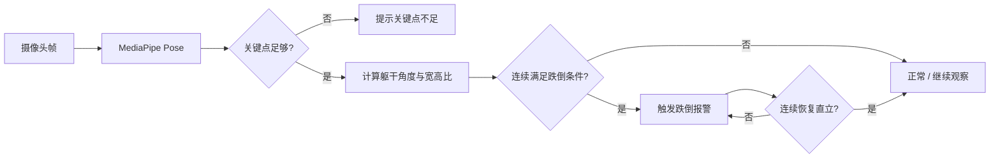

<div align="center">

# 🛡️ 人员跌倒检测 · Fall Detection

**基于 MediaPipe Pose + OpenCV + Flask 的本地实时跌倒检测系统**

<p>
  <a href="https://github.com/mrn1234567/fall-detection"></a>
  <a href="https://github.com/mrn1234567/fall-detection"></a>
  
  
  
</p>

一个开箱即用的单人场景跌倒检测 Demo：摄像头画面在本地处理，浏览器实时显示检测框、姿态指标与报警状态。

<p>
  <a href="#-快速开始">快速开始</a> ·
  <a href="#-功能亮点">功能亮点</a> ·
  <a href="#-检测逻辑">检测逻辑</a> ·
  <a href="#-接口一览">接口一览</a>
</p>

</div>

> [!IMPORTANT]
> 本项目仅用于学习、演示与辅助检测，不能替代人工看护、医疗判断或专业安全设备。

## ✨ 功能亮点

<table>
  <tr>
    <td width="50%"><b>🎥 本地实时视频</b><br>通过 OpenCV 读取摄像头，Flask 以 MJPEG 流展示画面。</td>
    <td width="50%"><b>🧍 姿态关键点分析</b><br>使用 MediaPipe Pose 提取肩部、髋部和下肢关键点。</td>
  </tr>
  <tr>
    <td><b>🚨 连续帧防误报</b><br>疑似跌倒需连续约 7 帧命中才报警，避免单帧抖动触发。</td>
    <td><b>♻️ 自动恢复 + 手动复位</b><br>重新站直并保持约 10 帧自动解除，也支持按钮复位。</td>
  </tr>
  <tr>
    <td><b>📊 实时指标面板</b><br>展示躯干角度、身体宽高比、连续帧数和关键点置信等级。</td>
    <td><b>🔒 隐私友好</b><br>默认在本机处理视频，不需要上传云端或第三方账号。</td>
  </tr>
</table>

## 🖥️ 界面预览

项目自带深色玻璃拟态风格控制台，包含实时视频、状态灯、报警按钮和指标卡片：

```text
┌──────────────────────────────────────────────────────────┐
│  ⚠  人员跌倒检测                 ● 正常   [手动复位报警] │
├──────────────────────────────────────────────────────────┤
│                                                          │
│                 摄像头实时画面 + 检测框                  │
│                                                          │
├────────────────────────┬─────────────────────────────────┤
│ 实时数据                │ 判定说明                        │
│ 角度  89.4°             │ 站立 ≈ 90°，平躺 ≈ 0°           │
│ 身体比 1.86             │ 连续命中后触发红色报警          │
│ 置信度 高               │ 支持自动恢复与手动复位          │
└────────────────────────┴─────────────────────────────────┘
```

## 🧠 检测逻辑



核心判定指标：

- **躯干角度**：站立约 `90°`，平躺接近 `0°`。
- **身体宽高比**：辅助判断身体是否呈横向展开。
- **连续帧计数**：默认连续 `7` 帧命中后报警，连续 `10` 帧恢复直立后解除报警。
- **置信等级**：根据可见关键点数量与肩髋关键点完整度给出高 / 中 / 低等级。

## 🚀 快速开始

### 1. 安装依赖

```bash
git clone https://github.com/mrn1234567/fall-detection.git
cd fall-detection
python -m pip install -r requirements.txt
```

### 2. 启动本地服务

```bash
python fall_backend.py
```

打开浏览器访问：<http://127.0.0.1:5000>

### 3. 运行核心测试

不连接摄像头也可以验证判定逻辑：

```bash
python -m unittest -v test_fall_detection.py
```

停止服务：在终端按 `Ctrl + C`。

## 🗂️ 项目结构

```text
fall-detection/
├── fall_backend.py              # Flask 服务、视频流与状态 API
├── fall_detection.py            # MediaPipe 姿态分析与状态机
├── 人员跌倒检测.html             # 深色风格实时控制台
├── test_fall_detection.py       # 核心逻辑测试
├── clean_pose_data.py           # 姿态数据清洗工具
├── generate_demo_pose_data.py   # 生成演示数据
├── verify_clean.py              # 清洗结果校验
├── requirements.txt             # Python 依赖
└── 运行说明_后端跌倒检测.txt      # 中文运行说明
```

## 🔌 接口一览

| 方法 | 路径 | 作用 |
| --- | --- | --- |
| `GET` | `/` | 返回实时检测控制台 |
| `GET` | `/video_feed` | 返回摄像头 MJPEG 视频流 |
| `GET` | `/status` | 返回当前状态、角度、比例和置信度 |
| `POST` | `/reset` | 手动复位跌倒报警 |

示例：

```bash
curl http://127.0.0.1:5000/status
curl -X POST http://127.0.0.1:5000/reset
```

## ⚙️ 参数调优

在 `fall_detection.py` 的 `FallDetector.__init__` 中可以调整：

| 参数 | 默认值 | 说明 |
| --- | ---: | --- |
| `fall_angle` | `38°` | 越大越灵敏，也更容易把弯腰判为跌倒 |
| `recover_angle` | `62°` | 判定恢复直立的角度阈值 |
| `fall_ratio` | `0.92` | 身体横向展开的辅助阈值 |
| `fall_frames` | `7` | 触发报警所需连续命中帧数 |
| `recover_frames` | `10` | 自动解除报警所需连续恢复帧数 |
| `min_visibility` | `0.45` | 关键点最低可见度 |

## 📌 使用建议

- 固定摄像头，尽量拍到肩、髋和腿部。
- 保证人物在画面中占据一定区域，避免逆光和严重遮挡。
- 当前版本按**单人场景**设计，多人同时出现时只跟踪主要人物。
- 如需更低延迟或更高精度，可进一步调整摄像头分辨率与 MediaPipe 参数。

## 🧰 技术栈

`Python` · `OpenCV` · `MediaPipe Pose` · `NumPy` · `Flask` · `HTML/CSS/JavaScript`

## 📄 License

当前仓库尚未声明开源许可证。如需公开分发，建议根据使用场景补充合适的 License 文件。

<div align="center">

Made with ❤️ for safer computer-vision prototypes

</div>
